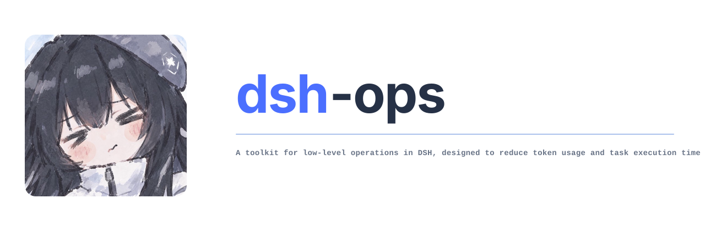

  

  <strong>English</strong> | <a href="README.zh.md">简体中文</a>

  

  
  
  
  

# dsh-ops

A plugin dedicated to improving the token efficiency of DSH plugins, boosting AI performance, reducing token consumption, and cutting total task time. It removes the token, time, and model-attention waste caused by DSH repeatedly hitting PowerShell errors on Windows, and will keep being updated.

Main features of this plugin:

- A set of more advanced always-on tools written in Rust. Compared with the built-ins, these tools use fewer input and output tokens, run faster, cover more ground, and impose less mental load on the AI; they also carry brief hash checks, line/position info, and similar messages to reduce token overhead.
- Through progressive disclosure, it provides everyday tools such as DOC/PDF operations, web search, and crawl4ai-style HTML-to-Markdown tools. These save a lot of tokens by letting the AI avoid writing one-off code or scripts to reach its goal.
- Provides an option to disable the built-in tools, to maximize savings on the AI's mental load and the fixed system prompt.
- On Windows it additionally provides the `ops_bash` tool — the AI is far more fluent with bash than with pwsh. You can use the independent **bash 5.3.15** bundled with ops, or point the `ops_bash` tool at Git Bash.

> tips: "ops" here is short for the broad sense of operations (running operations), indicating that this plugin sits in the base-tool position between DSH and system/code/file operations. This is not an operations (ops/SRE) plugin.

## Install, update and uninstall
